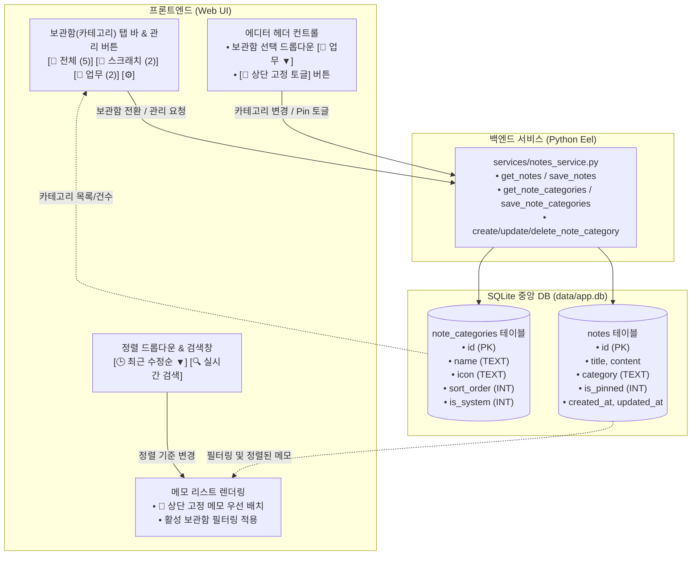

# 🗂️ [Plan] 빠른메모(Notes) 카테고리(상위 보관함) 분류 및 정렬 순서 관리 구현 계획서 (#8)

## 1. 개요 및 배경 (Overview & Background)

현재 빠른메모(Notes & Scratchpad) 모듈은 모든 메모가 단일 평면 목록(Flat List)으로 관리되고 있어 다음과 같은 구조적 한계가 존재합니다:
1. **상위 보관함(게시판) 분류 체계 부재**:
   - 메모의 수량이 증가함에 따라 업무, 개인, 임시 스크래치, 프로젝트 등 용도별로 메모를 분리하여 탐색하기 어렵습니다.
2. **다양한 정렬 기준 및 중요 메모 고정 기능 부재**:
   - 단순히 최근 수정 메모가 맨 위로 올라오는 단일 방식(LRU)만 지원하여, 자주 참고하는 중요 메모를 상단에 고정(Pin)하거나 제목순/생성일자순으로 정렬하는 옵션이 없습니다.

본 계획은 [**GitHub Issue #8**](https://github.com/JudeRester/Util-Tools/issues/8)에 기반하여 **① SQLite 기반 상위 보관함(카테고리) 데이터 모델 구축**, **② 좌측 보관함 탭 & 인레이어 관리 UI**, **③ 에디터 내 보관함 이동 및 📌 상단 고정(Pin) 기능**, **④ 4대 정렬 옵션(수정순/최신순/과거순/가나다순) 및 설정 영속화**를 구현하는 것을 목표로 합니다.

---

## 2. 전체 아키텍처 및 데이터 모델 (Architecture & Data Model)



---

## 3. 세부 설계 명세 (Detailed Specifications)

### 1) SQLite 데이터베이스 스키마 확장

#### ① `note_categories` 테이블 신설 ([`services/db_service.py`](file:///D:/python/services/db_service.py))
```sql
CREATE TABLE IF NOT EXISTS note_categories (
    id TEXT PRIMARY KEY,
    name TEXT NOT NULL,
    icon TEXT DEFAULT '📁',
    sort_order INTEGER DEFAULT 0,
    is_system INTEGER DEFAULT 0,       -- 1: 전체/스크래치 등 시스템 고정, 0: 사용자 생성
    created_at TEXT DEFAULT (datetime('now', 'localtime')),
    updated_at TEXT DEFAULT (datetime('now', 'localtime'))
);
CREATE INDEX IF NOT EXISTS idx_note_categories_order ON note_categories(sort_order ASC);
```

#### ② 기본 시스템 카테고리 프리셋 (Default Seeding)
- `all`: `📌 전체 메모` (`sort_order = 0`, `is_system = 1` - 모든 메모 합산 조회, 삭제/이름변경 불가)
- `scratch`: `🧪 스크래치패드` (`sort_order = 1`, `is_system = 1` - 기본 폴백 보관함)
- `work`: `💼 업무` (`sort_order = 2`, `is_system = 0`)
- `personal`: `🏠 개인` (`sort_order = 3`, `is_system = 0`)

#### ③ 기존 `notes` 테이블과의 관계 및 마이그레이션
- `notes` 테이블의 기존 `category` 컬럼 값을 `note_categories.id`와 매핑.
- 카테고리 삭제 시, 해당 보관함에 속해 있던 기존 메모들은 삭제되지 않고 기본 폴백 보관함(`scratch`)으로 안전하게 자동 이전됩니다.

---

### 2) 백엔드 서비스 API (`services/notes_service.py`)

- `@eel.expose def get_note_categories()`:
  - 카테고리 목록과 각 카테고리별 소속 메모 개수(`notes_count`)를 집계하여 반환.
- `@eel.expose def save_note_category(cat_id, name, icon)`:
  - 신규 카테고리 추가 또는 기존 카테고리 정보 수정.
- `@eel.expose def delete_note_category(cat_id)`:
  - 시스템 카테고리(`is_system = 1`) 보호 가드 적용.
  - 삭제 대상 카테고리에 속한 메모들의 `category`를 `'scratch'`로 일괄 이전 후 카테고리 레코드 삭제.
- `@eel.expose def reorder_note_categories(ordered_ids)`:
  - 사용자 드래그 또는 상/하 이동 순서에 맞춰 `sort_order` 일괄 갱신.

---

### 3) 정렬 순서 정책 및 알고리즘 (Sorting Policy)

```
[최종 표시 순서]
  1순위: 📌 상단 고정 메모 (is_pinned = 1) -> 선택된 정렬 기준 적용
  2순위: 📄 일반 메모 (is_pinned = 0)     -> 선택된 정렬 기준 적용
```

- **4대 정렬 옵션**:
  1. 🕒 **최근 수정순 (Default)**: `updated_at DESC` (메모 입력 또는 복사 시 최상단 배치)
  2. 📅 **최신 생성순**: `created_at DESC`
  3. ⏳ **오래된 생성순**: `created_at ASC`
  4. 🔤 **제목 가나다/알파벳순**: `title ASC` (특수문자/한글/영문 사전순)
- **정렬 설정 영속화**:
  - 사용자가 선택한 정렬 기준은 `localStorage.getItem('notes_sort_option')`에 자동 영속화되어 앱 재실행 시 유지.

---

### 4) 프론트엔드 UI / UX 인터랙션

1. **좌측 사이드바 상단 보관함(카테고리) 탭 바**:
   - 가로 스크롤 가능한 칩 탭 바 배치: `[📌 전체 (5)] [🧪 스크래치 (2)] [💼 업무 (2)] ... [➕]`
   - 클릭 시 해당 보관함 활성화 및 실시간 필터링.
   - `[⚙️ 보관함 관리]` 버튼 클릭 시 인레이어 모달(보관함 추가/이름변경/삭제/순서변경) 호출.
2. **검색 및 정렬 툴바**:
   - 검색창 우측에 정렬 셀렉트 드롭다운 `[🕒 최근 수정순 ▼]` 배치.
3. **메모 카드 렌더링**:
   - 카테고리 뱃지 (`📁 업무`) 및 고정 아이콘 (`📌`) 표시.
4. **에디터 상단 헤더 인터랙션**:
   - 제목 입력창 상단에 **보관함 지정 드롭다운**(`[ 📁 보관함 이동 ▼ ]`) 및 **📌 상단 고정 버튼** 배치.
   - 클릭 즉시 메모의 보관함 및 고정 상태가 SQLite DB에 반영되고 좌측 목록에 실시간 반영.

---

## 4. 파일별 변경 계획 및 구현 범위

| 구분 | 대상 파일 | 주요 변경 내용 |
| :--- | :--- | :--- |
| **DB** | [`services/db_service.py`](file:///D:/python/services/db_service.py) | `note_categories` 테이블 생성, 인덱스 추가, 기본 프리셋 시딩 로직 구현 |
| **Backend** | [`services/notes_service.py`](file:///D:/python/services/notes_service.py) | • 카테고리 CRUD API 구현 (`get_note_categories`, `save_note_category`, `delete_note_category`, `reorder_note_categories`)<br>• `get_notes` / `save_notes` 시 카테고리 및 `is_pinned` 필드 완결성 보장 |
| **Frontend HTML** | [`web/index.html`](file:///D:/python/web/index.html) | 빠른메모 좌측 사이드바 상단 카테고리 칩 바 컨테이너, 정렬 셀렉트, 에디터 헤더 보관함 드롭다운 & Pin 버튼 마크업, 보관함 관리 인레이어 모달 추가 |
| **Frontend JS** | [`web/js/notes.js`](file:///D:/python/web/js/notes.js) | • 카테고리 목록 로드 및 칩 바 렌더링<br>• 카테고리별 필터링 및 4대 정렬 옵션 알고리즘 구현<br>• 보관함 변경 및 📌 상단 고정 토글 핸들러 구현<br>• 보관함 관리 모달(추가/수정/삭제/순서이동) 로직 구현 |
| **Frontend Style** | [`web/style.css`](file:///D:/python/web/style.css) | 카테고리 칩 바, 정렬 셀렉트, 메모 카드 뱃지, 에디터 툴바 드롭다운, 보관함 관리 모달 스타일링 |

---

## 5. 검증 및 테스트 계획 (Verification Plan)

1. **자동화 무결성 검증 (`python scripts/verify_integrity.py`)**:
   - Python 전수 컴파일 및 신규 DB 테이블 마이그레이션 정상 가동 확인 (19개 테이블 검증).
   - JavaScript 문법 검사 (`node -c`) 및 CSS 괄호 짝 일치 검증 통과.
2. **백엔드 기능 단위 테스트 (`scripts/test_notes_category_functional.py`)**:
   - 기본 카테고리 시딩 및 조회 검증.
   - 카테고리 추가/수정/삭제(소속 메모의 스크래치패드 자동 이전 확인) 검증.
   - 핀 고정 및 정렬 기준별 쿼리 순서 검증.
3. **사용자 실화면 수동 검수 (User Sign-off Gate)**:
   - 카테고리 칩 클릭 시 필터링 즉시 반영 확인.
   - 에디터에서 보관함 변경 및 📌 고정 토글 즉시 반영 확인.
   - 정렬 옵션 변경 시 목록 재정렬 및 새로고침 후 설정 유지 확인.
